# Next Up

**Next Up turns the folders of films and TV on your computer into your own streaming service.** It builds a library with posters, plots and cast lists, suggests what to watch tonight, remembers where you stopped in everything, and plays it all in the mpv video player. It runs entirely on your own machine: no accounts, no subscriptions, no adverts.

There's also an Android app that keeps films on the phone, streams from the PC over home Wi-Fi, and works as a remote for the PC.

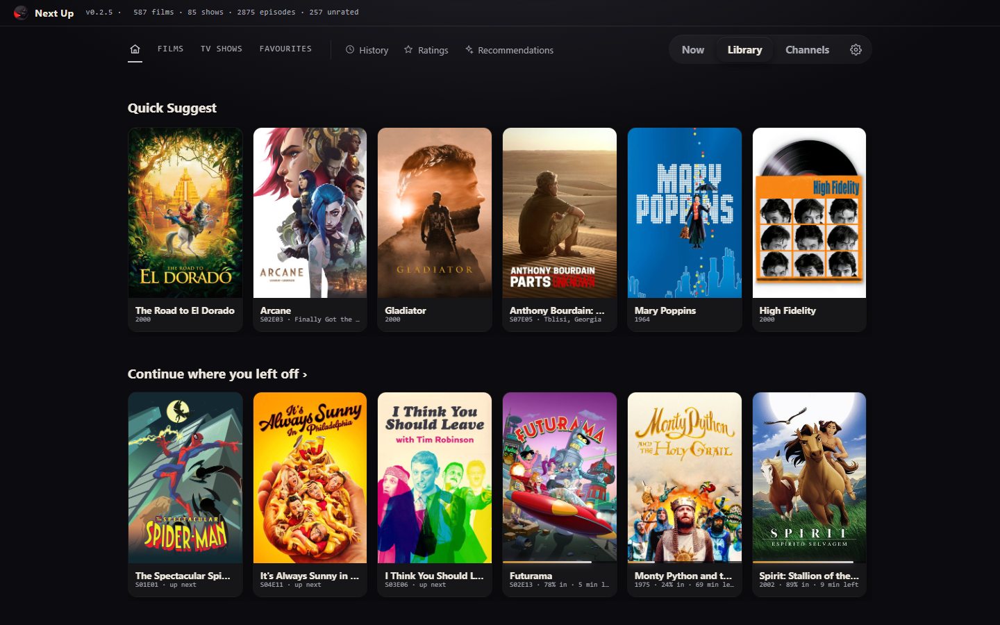

Downloads are on the [Releases page](https://github.com/jameshghc/NextUp/releases). The repository is private, so you'll need to have been invited. What changed in each version is in [CHANGELOG.md](CHANGELOG.md).

---

## What it looks like

**Now** picks one thing for tonight and says why, with everything you're part-way through along the top. Narrow it down with Anything, Film or TV and the genres beside it; **NEXT** for another.

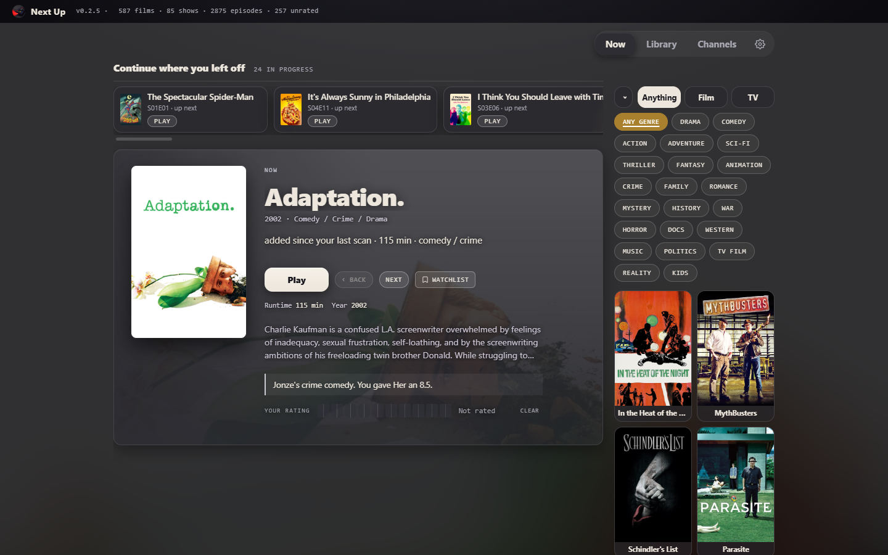

**The Library** has everything you own as posters: sort it by your own score, TMDB's, what's new or what you watched last, and search by title, director, actor or genre. Your score is in the corner; the heart is a favourite.

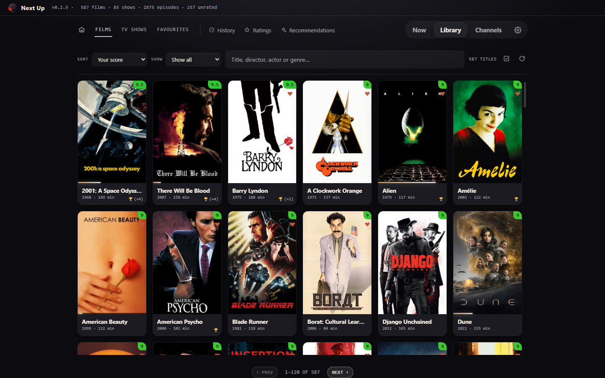

**Channels** are TV channels made from your own collection, always on, with a guide. There are 22 of them, from Action, Comedy and Saturday Morning cartoons to Anime, World Cinema, In Black & White and your Watchlist, plus Directors Cut and Type Cast, which run one director's or actor's films back to back. Put them in whatever order you like by changing a channel's number. Hover over anything to see what it is; a block of a few episodes shows which one's on now and what's after it.

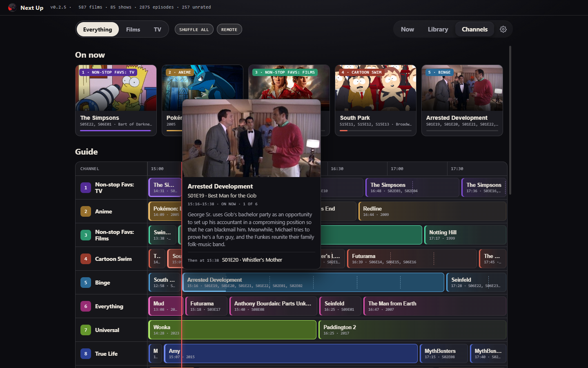

**Recommendations** finds what's missing: the rest of a series or a collection you've started, and films and shows like the ones you rate highly. **REFRESH** works out a new lot.

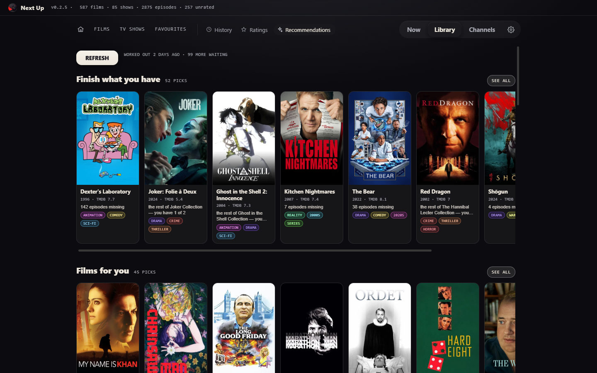

**A film's page** has the cast and what else you own of theirs, similar films you have, and the facts: release, budget, box office. Films not in English say what language they're in.

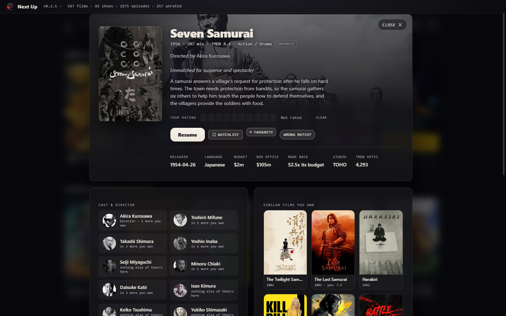

**A show's page** has scores for every season and episode. Click an episode's name for its picture, plot, director and guest stars; click its code (S02E03) to say you're up to there.

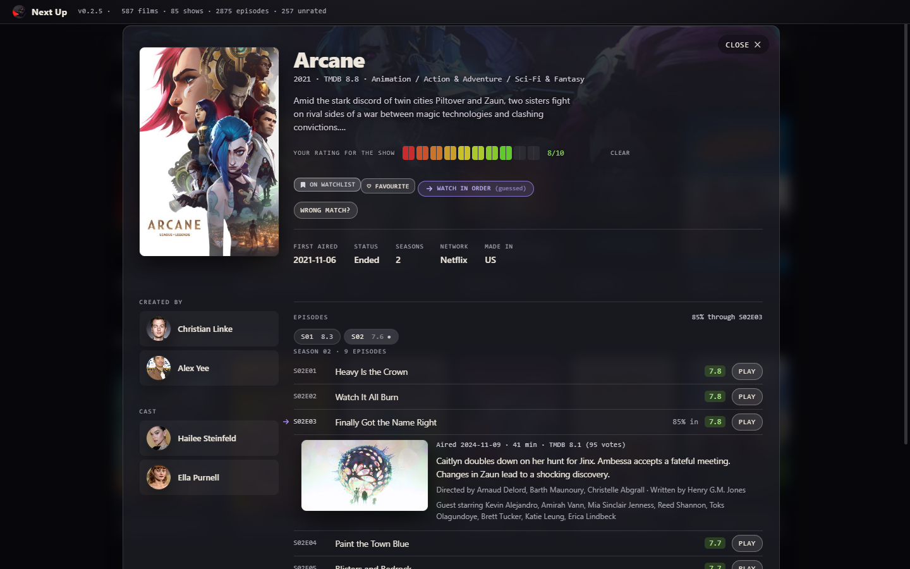

**Watch in order.** Some shows you dip into anywhere (Seinfeld, Always Sunny); others are one story (Arcane, Attack on Titan), where a random episode is the wrong thing to be offered. A show that's in order is only ever suggested at the episode you're up to, on Now, Home and the channels, and the purple arrow on its poster says so. Next Up guesses which kind a show is from its genre and how you've been watching it, and says *(guessed)* until you decide: press **WATCH IN ORDER** on the show's page to switch it on or off.

**Rate** works through what you haven't scored yet, films or TV shows. The more you rate, the better everything else gets.

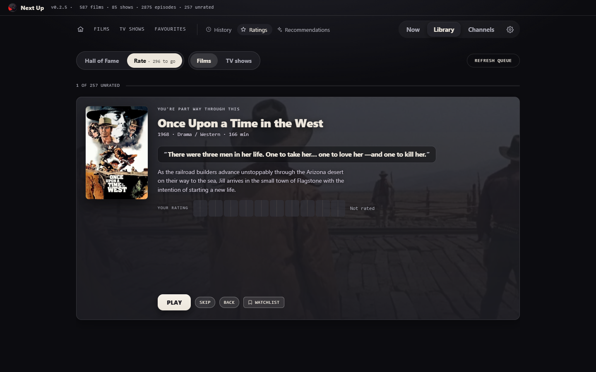

**Hall of Fame** is what you've rated, on shelves: your top 12, your top TV, and the best of every genre.

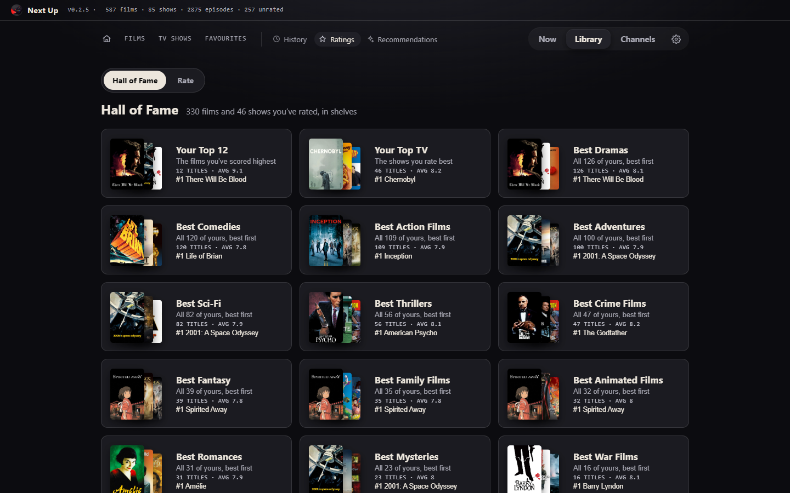

**Settings › Appearance** changes the look: Classic, Glass or Silver, three fonts, an accent colour, how strong the glass is, how much of the film's art shows behind the page, and how round the corners are.

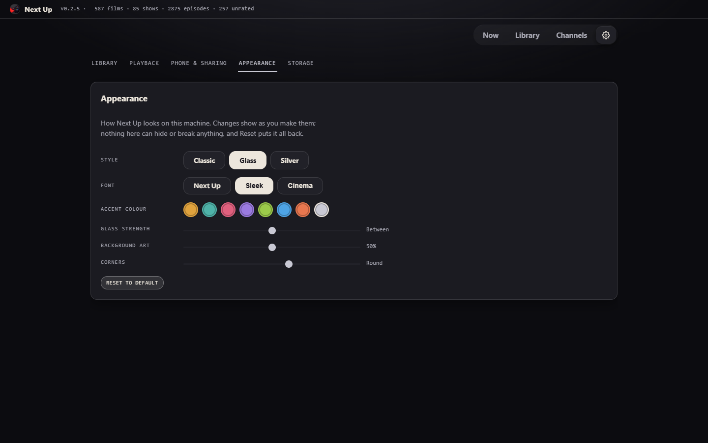

### On the phone

The Android app has the same pages. Paired with the PC, it shows the PC's whole library: play anything **▶ HERE** (streamed over Wi-Fi) or **▶ ON PC**, and use it as the remote.

| Home | Now | Channels | Remote |
|---|---|---|---|
| 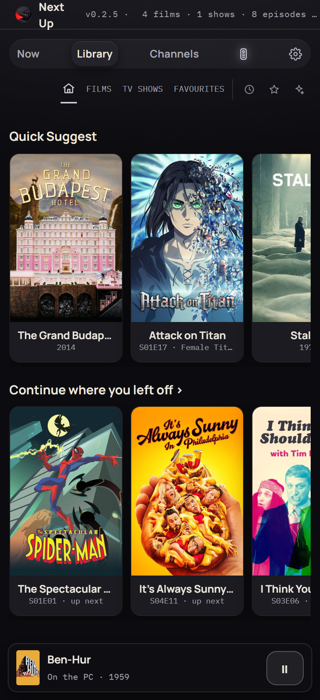 | 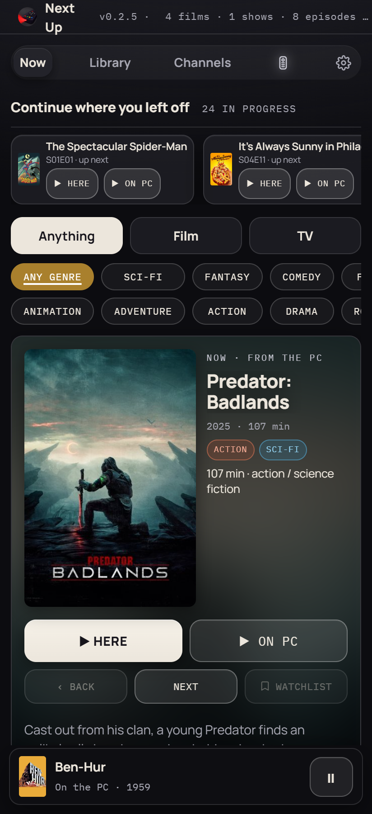 | 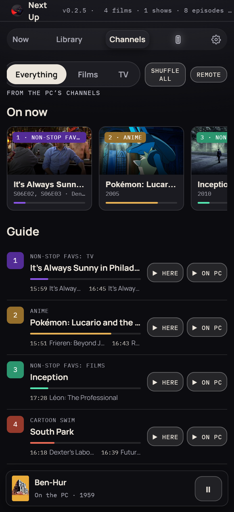 | 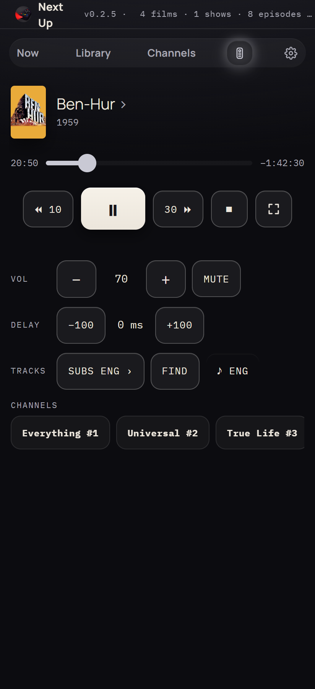 |

---

## You'll need

- **mpv**, the free player that does the actual playing. On Windows, in PowerShell: `winget install --id shinchiro.mpv -e`. On a Mac: `brew install mpv`. On Android: **mpv-android** from the [Play Store](https://play.google.com/store/apps/details?id=is.xyz.mpv) or [F-Droid](https://f-droid.org/packages/is.xyz.mpv/).
- **A free TMDB key**, so Next Up can recognise your files and fetch artwork. Make an account at [themoviedb.org](https://www.themoviedb.org/signup), then go to [Settings › API](https://www.themoviedb.org/settings/api), choose **Developer** and fill in the short form (personal use, URL `http://localhost` is fine). Copy the short **API Key**, not the long "Read Access Token". Without a key it still works, but only knows your files by name.

## Installing

### Windows
1. Download `NextUp-<version>-windows.exe` and put it in **a folder of its own**, e.g. `Documents\Next Up` (not `Program Files`). Everything it learns is saved in that folder.
2. Double-click it. If Windows says **"Windows protected your PC"**, click **More info › Run anyway**. It's unsigned, not unsafe.

### Mac (from source)
There's no packaged Mac app; it runs straight from the source.
1. Install mpv (`brew install mpv`) and Python 3.
2. Get the source: clone the repository, or download **Source code (zip)** from the release.
3. In Terminal, from inside the folder: `sh run.sh`. The first run sets up a local Python environment in `.venv` and installs pywebview; after that it starts straight away.

### Android
1. Install mpv-android (above).
2. Copy `NextUp-<version>-android.apk` to the phone and tap it in **Files**. Allow installing from that source when Android asks, and **Install anyway** if Play Protect queries it.
3. Open Next Up and allow it to access videos. The phone's own films live in **Movies › Film & TV**.

### Updating
Replace the exe (or `git pull` / a fresh source zip on the Mac, or install the new APK over the old one). Your library, ratings and settings stay in the folder, so they carry over.

---

## Getting started

1. Pick yourself on the **Who's watching?** screen.
2. Open **Settings** (the gear) › **Library**. Type your media folders, one per line, and press **SAVE**. Paste your TMDB key and press **SAVE KEY**. Press **TEST MPV** if you want to check the player is found.
3. Press **SCAN MY FOLDERS**. The first scan takes a few minutes on a big collection; after that it only looks at what's new.

Tidy names help it recognise things: `Heat (1995)\Heat (1995).mkv` for films, and a folder per show with `S01E01` in every episode's name. Subtitles named like the video are picked up. If something comes out wrong, correct it on its page in the Library; the fix survives future scans.

## Using it

- **Library** opens on **Home**: suggestions and everything you're part-way through. Then Films, TV, Favourites, History and Recommendations, with search, Sort and Show. Click a poster for its page; right-click to play, queue, favourite or add to your watchlist. A show's page has season and episode scores.
- **Now** suggests one thing for tonight, with the reason. Narrow it with Film/TV and genres; **NEXT** for another.
- **Rate** works through what you haven't scored. The more you rate, the better the suggestions.
- **Channels** are TV-style channels made from your own collection, always "on". You join part-way through. **SHUFFLE ALL** deals out a new schedule; click a channel's number to give it a different one and move it there. Shows you're watching in order only ever put on your next episode.
- **Recommendations** (in the Library) groups what's worth getting next: the rest of what you've started, then films and shows for you. **REFRESH** looks again; the scan also runs by itself when your library changes.
- **"Are you still watching?"** If nothing's been touched for a while, it pauses and asks; if nobody answers, it rewinds ten minutes and closes the player. Timings are in Settings › Playback.
- **The remote** (the REMOTE button, or the phone) has play/pause, seeking, volume, subtitles (**FIND** fetches them from OpenSubtitles, with a free key in Settings › Playback), audio track, and an audio delay remembered per film.
- **Closing the window** on Windows hides Next Up in the system tray so the phone keeps working. Right-click the tray icon to quit, or switch this off in Settings › Playback.
- **Settings › Appearance** has Classic or Glass, an accent colour and more. **Settings › Storage** shows what's kept where and exports your ratings and history.

## The phone with the PC

Pair once over USB, and then they work together on home Wi-Fi:

1. On the phone, turn on **USB debugging** (Settings › About phone › Software information, tap **Build number** seven times, then Developer options › USB debugging).
2. On the PC: `winget install Google.PlatformTools`, then restart Next Up.
3. Plug the phone in, open Next Up on it, and tap **Allow** on the USB debugging prompt.
4. On the PC, **Settings › Phone & sharing › SEND MY LIBRARY**. This sends your library list, ratings, history and TMDB key (never video files) and pairs the two.

After that, with both on the same Wi-Fi and Next Up open on the PC, the phone shows the PC's whole library. Anything can play **▶ HERE** (streamed if the phone hasn't got a copy) or **▶ ON PC**, and a **Remote** tab appears. To copy films onto the phone, plug it in and use the tick button in the PC's Library.

---

## If something's wrong

- **Nothing plays / can't find mpv:** restart Next Up after installing mpv, or put the full path to it in Settings › Library and press SAVE.
- **Nothing found, or "not identified":** press SAVE before SCAN; check the TMDB key is the short API Key, then **RETRY UNIDENTIFIED**.
- **The phone can't see the PC:** usually Windows Firewall. In an **administrator** PowerShell:
  ```
  New-NetFirewallRule -DisplayName "Next Up phone link (TCP)" -Direction Inbound -Protocol TCP -LocalPort 8790 -RemoteAddress LocalSubnet -Action Allow
  New-NetFirewallRule -DisplayName "Next Up phone link (UDP)" -Direction Inbound -Protocol UDP -LocalPort 8790 -RemoteAddress LocalSubnet -Action Allow
  ```
  Also delete any **Block** rules naming Next Up (Windows Defender Firewall with Advanced Security › Inbound Rules), set your home network to **Private**, turn off a VPN's LAN hiding (NordVPN: **Invisibility on LAN**), and keep the phone off guest Wi-Fi.
- **SEND MY LIBRARY can't see the phone:** check USB debugging is on and allowed, Next Up is open on the phone, and try another cable (some only charge).
- **"Something else is using port 8770":** Next Up is probably already running; look in the system tray.

## Privacy

Your library, ratings, history and settings stay on your own devices. Next Up only goes online to ask TMDB about titles, OpenSubtitles when you press FIND, and YouTube for the Al Jazeera channel. Keys and passwords are kept in plain text in `nextup_config.json`, so don't share that file. To back up, copy the folder; the file that matters is `nextup_library.db`.

## For developers

`nextup.py` is the whole app. `build_windows.py` makes the exe, `android/build.py` the APK, and `tests/run_all.py` runs the tests (see [tests/README.md](tests/README.md)). The working log is [DEVELOPMENT_NOTES.md](DEVELOPMENT_NOTES.md), and what's still to do is in [PLANNED.md](PLANNED.md).
