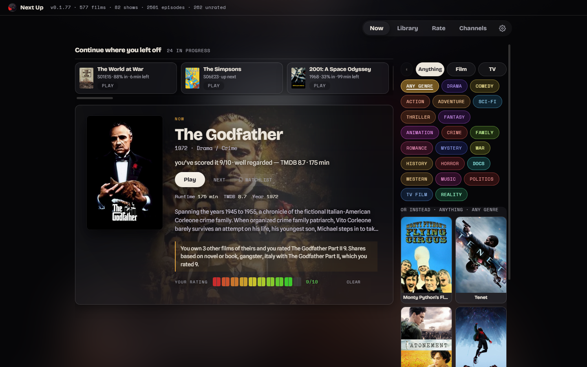
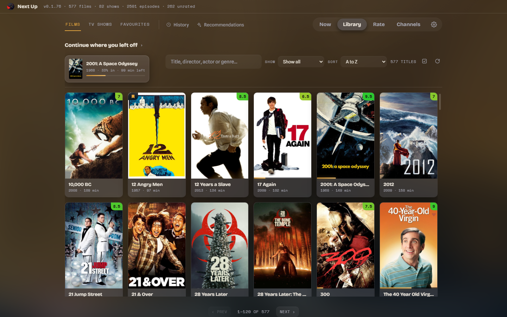
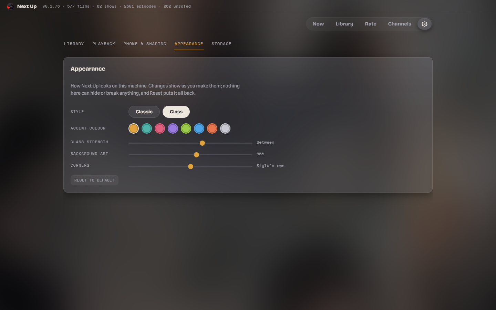
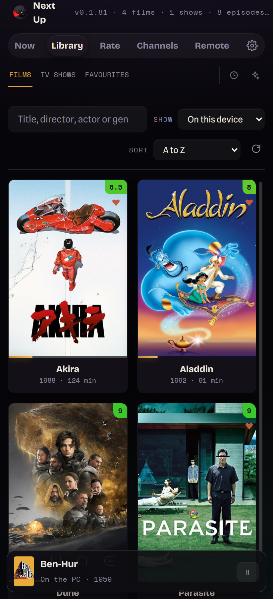
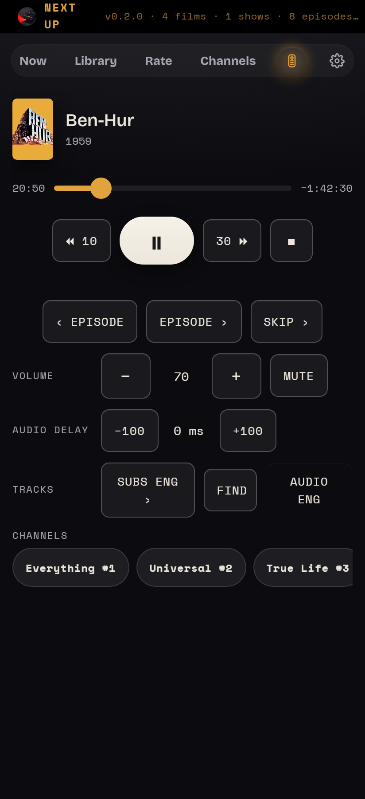

# Next Up

**Next Up turns the folders of films and TV on your PC into something that feels like your own streaming service.** Point it at where your films and shows live and it builds a proper library from them, with posters, plots and cast lists. Then it helps with the hard part, which is deciding what to watch tonight. It remembers where you stopped in everything, and it plays things in a proper video player. It runs entirely on your own computer. There are no accounts, no subscriptions and no adverts, and nothing about what you watch leaves the house.

There's also an Android app. It can keep films on the phone for watching anywhere, play things from the PC over your home Wi-Fi, or act as a remote control for the PC.



Why people like it:

- **It picks something for you.** No more scrolling for twenty minutes. Choose a mood or a genre and it suggests something you own and haven't seen, or something you loved.
- **It carries on where you left off,** with every film and episode, on the PC or the phone.
- **Channels.** Twenty-odd TV-style channels made out of your own collection, always "on", so you can just drop in.
- **It looks after you.** If you nod off, it notices, pauses, and rewinds ten minutes so you don't lose your place.

---

## Contents

1. [What you need](#what-you-need)
2. [Installing and first run](#installing-and-first-run)
3. [How to organise your folders](#how-to-organise-your-folders)
4. [A tour of the app](#a-tour-of-the-app)
5. [The phone app](#the-phone-app)
6. [Troubleshooting](#troubleshooting)
7. [Privacy](#privacy)
8. [FAQ](#faq)

---

## What you need

### A Windows PC
Windows 10 or Windows 11. That's all the PC needs, plus the two things below.

### mpv, the video player
Next Up does the choosing. A free player called **mpv** does the playing, and it handles almost any video file you throw at it.

The easiest way to install it is to open **PowerShell** (press Start, type `PowerShell`, press Enter) and paste in:

```
winget install --id shinchiro.mpv -e
```

If you'd rather download it yourself, go to [mpv.io/installation](https://mpv.io/installation/) and pick a Windows build. Then **either** put `mpv.exe` in the same folder as Next Up (the simplest option, because Next Up looks there first), **or** note where you saved it so you can tell Next Up later.

### A free TMDB key
TMDB (The Movie Database) is a free, community-run site with information about almost every film and TV show. Next Up uses it to recognise your files and fetch posters, plots, cast and genres. You need your own key, which is a sort of password that lets an app ask TMDB questions. It's free and takes about five minutes:

1. Go to [themoviedb.org](https://www.themoviedb.org/signup) and create an account. Confirm your email address.
2. Once you're signed in, click your profile picture (top right), then **Settings**, then **API** on the left. The direct link is [themoviedb.org/settings/api](https://www.themoviedb.org/settings/api).
3. Click **Create** (or "Request an API key"), and choose **Developer**.
4. Accept the terms, then fill in the short form. Something like this is fine:
   - Type of use: **Personal**
   - Application name: **Next Up**
   - Application URL: **http://localhost**
   - Summary: **Personal media library on my own PC**
5. Submit it, and you'll see your keys. Copy the one labelled **API Key**, which is a 32-character jumble of letters and numbers. *Not* the much longer "API Read Access Token": Next Up needs the short one.

Without a key Next Up still works, but it only knows your films by their file names. That means no posters and no suggestions.

### Optional: an Android phone
For the phone app you'll also want **mpv-android**, the phone version of the player. It's free on the [Google Play Store](https://play.google.com/store/apps/details?id=is.xyz.mpv) and on [F-Droid](https://f-droid.org/packages/is.xyz.mpv/). There's more in [The phone app](#the-phone-app).

---

## Installing and first run

### 1. Put it in its own folder
Download `NextUp-0.2.0-windows.exe` and make a new folder for it somewhere you can save files, such as `Documents\Next Up`. Move the exe into that folder.

Next Up keeps everything it learns (your library, ratings, settings and posters) **in the same folder as the exe**. That's why it wants a folder of its own. It also means:

- **Don't** put it in `C:\Program Files`, because normal programs aren't allowed to save files there.
- To back up everything, copy the folder. The one file that really matters is `nextup_library.db`.
- The first time it runs, a few files appear next to it, such as `nextup_fonts` and `nextup_logo.png`. That's normal.

### 2. Start it
Double-click the exe.

Windows may say **"Windows protected your PC"**. That happens because Next Up is a small home-made app that hasn't paid for a code-signing certificate, not because anything is wrong. Click **More info**, then **Run anyway**. Windows only asks once.

### 3. Who's watching?
The first screen asks who's watching. A profile with your Windows name is already there, so just click it. (Tick **Go straight in next time** if you're the only one using it.)

### 4. Tell it where your films are
Click the **gear icon** (top right) to open **Settings**, then the **Library** tab.

1. Under **Media folders**, type the folders where your films and TV live, **one per line**. For example:
   ```
   D:\Films
   D:\TV Shows
   ```
   It looks inside every subfolder too, so the top folder is enough.
2. If you didn't put `mpv.exe` beside Next Up and it isn't in a usual place, paste its full path into **Path to mpv.exe**. If you installed it with winget, you can leave this blank. Press **TEST MPV** to check: it should show a version number.
3. Press **SAVE**. This matters: SCAN uses the folders you've *saved*, not what's typed in the box.
4. Scroll down to **TMDB key**, paste your API key and press **SAVE KEY**.
5. Press **SCAN MY FOLDERS**.

The first scan takes a few minutes on a big collection, because it looks up every title and downloads the artwork. After that it only looks at what's new, and it checks for new files by itself each time it starts.

You may also see a question about **sharing through OneDrive**. That's for keeping several *computers* in step, so you can press **Not now** if you only have one.

---

## How to organise your folders

Next Up works out what each file is from its name, so tidy names help. It copes with most things, including messy download names such as `Paddington.2.2017.1080p.BluRay.x264.mkv`, but this layout is ideal:

```
D:\Films\
    Heat (1995)\
        Heat (1995).mkv
    Paddington 2 (2017)\
        Paddington 2 (2017).mkv

D:\TV Shows\
    Detectorists\
        Season 01\
            Detectorists S01E01.mkv
            Detectorists S01E02.mkv
```

The rules of thumb:

- **Films:** the title and the year in brackets.
- **TV:** a folder per show, and `S01E01`-style numbers in every episode's file name.
- **Subtitles:** put `.srt` files next to the video with the same name, and they're picked up.
- Files under **50 MB** are skipped, because they're nearly always samples or trailers. So are folders called things like `Extras`, `Featurettes` or `Samples`.

If something comes out wrong, open it in the Library and use the correction box on its page. Your fix survives every future scan.

---

## A tour of the app

There are four main tabs along the top, with Settings behind the gear.

### Now: what shall we watch?


- **Tonight's pick** sits in the middle: one film or show, with a line saying *why* it was picked (perhaps you rated something similar highly, or it's well regarded and you haven't seen it). **Play** starts it. **NEXT** suggests another one, and **BACK** goes back.
- **The chooser** on the right narrows things down. Pick **Film**, **TV** or **Anything**, then tap genres such as Comedy, Thriller or Docs. Tags combine, so Comedy plus Crime gives you comedy crime.
- **Continue where you left off** runs along the top, holding everything you're part-way through. Click one to carry on exactly where you stopped.
- Rate the pick with the coloured bar if you've seen it. That teaches the suggestions what you like.

### Library: everything you own


- **Films**, **TV Shows** and **Favourites**, with search (title, director, actor or genre), filters and sorting.
- Click a poster to see its page, with the plot, cast, your rating and similar things you own. **Right-click** a poster to **Play**, **Play next**, **Add to queue**, or mark it as a favourite or put it on your watchlist. Anything queued plays by itself after the current thing finishes.
- **History** lists what you've watched and when, with RESUME on anything unfinished.
- **Recommendations** suggests what's worth getting hold of next: episodes missing from seasons you own, films from series you've half-collected, more from directors and actors you like, and things picked from your own ratings.
- **Copying to a drive or the phone.** The tick button beside the search box lets you choose a USB drive (or a phone on the cable), tick posters and press **ADD**. It shows how much space it'll take first. Nothing is ever moved or deleted from the PC.
- A **DUPES** button appears if you own two copies of the same film. It helps you choose which to keep, and anything you remove goes to the Recycle Bin, never straight to deletion.

### Rate: teach it your taste
Rate works through everything you haven't scored yet, one at a time. Score it out of 10 if you know it, or **SKIP**. Underneath are your **top ten films and shows**. The more you rate, the better the picks on the Now page get.

### Channels: telly made from your own collection
About twenty channels run all the time, made out of what you own: **Everything**, **Comedy**, **Action**, **True Life** (documentaries), **Saturday Morning** (cartoons), **Directors Cut** (one director a day), **Binge** (shows you love, several episodes at a time), **Non-stop Favs** and more. Click one and you join it part-way through, like real television, and the next programme follows on by itself. **SHUFFLE ALL** deals out a fresh running order.

Two channels play from YouTube rather than your library: **Al Jazeera Live** (live news) and **Cold Ones** (a YouTube show). They need an internet connection and a small extra program called yt-dlp (`winget install yt-dlp.yt-dlp`). The rest work offline.

### "Are you still watching?"
Episodes roll into the next, the queue keeps going and channels never stop, so if you fall asleep a whole season could play out. After a while with nothing touched, Next Up **pauses** and asks whether you're still watching. If nobody answers, it **rewinds ten minutes** (so you can find your place tomorrow) and closes the player, which also lets the PC go to sleep. You can set how long it waits, separately for daytime, evening and after midnight, in **Settings > Playback**.

### While something's playing
mpv opens in its own window. Next Up's **remote** (the REMOTE button, or the phone) gives you pause, skip ±10 and 30 seconds, volume, subtitles and audio tracks.

- **Audio out of sync?** Nudge the **audio delay** on the remote. Next Up remembers the setting **for that film**, so it's right next time too.
- **No subtitles?** Press **FIND** on the remote and Next Up looks them up on OpenSubtitles and saves them next to the film. This needs a free OpenSubtitles API key in **Settings > Playback** (from opensubtitles.com, under *Consumers*). A free OpenSubtitles account raises the daily download limit.

### Settings
- **Library:** your folders, mpv, the TMDB key, and **RETRY UNIDENTIFIED** for anything that wasn't recognised.
- **Playback:** the "still watching?" timings and the subtitle service.
- **Phone & sharing:** the phone app, and optional syncing between several computers through OneDrive or another synced folder.
- **Appearance:** **Classic** or **Glass** style, an accent colour, how frosted the glass is, how much of the film's artwork shows through behind the page, and how rounded the corners are. **RESET** puts it all back. Nothing here can break anything.
- **Storage:** exactly what's stored and where, plus an **export** of your ratings and history.



---

## The phone app

 

The phone app is Next Up on Android. It does three jobs:

- **Its own library.** Films copied onto the phone play anywhere, offline, on a train.
- **Streaming from the PC.** When the phone and PC are on the same home Wi-Fi, everything on the PC can be played on the phone without copying it first.
- **A remote for the PC.** Control what's playing on the big screen from the sofa.

### Installing it
1. Install **mpv-android** from the [Play Store](https://play.google.com/store/apps/details?id=is.xyz.mpv) or [F-Droid](https://f-droid.org/packages/is.xyz.mpv/). Next Up hands films to it to play.
2. Get `NextUp-0.2.0-android.apk` onto the phone. You can copy it over the USB cable, email it to yourself, or put it in Google Drive.
3. Tap it in the phone's **Files** app (or Downloads).
4. Android will say something like **"For your security, your phone is not allowed to install unknown apps from this source."** That's Android's standard warning for any app that doesn't come from the Play Store. Tap **Settings**, switch on **Allow from this source**, go back, and tap **Install**.
5. Google Play Protect may also say it doesn't recognise the app. Tap **More details > Install anyway**.
6. Open Next Up and **allow it to access videos** when it asks, so it can see the films on the phone.

The phone keeps its own films in **Internal storage > Movies > Film & TV** (with `Films` and `TV` folders inside).

### Pairing with the PC: SEND MY LIBRARY
The first link-up happens over the USB cable. It sends the phone your whole library list (titles, posters, your ratings, favourites and history, *never* the video files), plus your TMDB key, and pairs the two for Wi-Fi.

You need to do three things once:

1. **Turn on USB debugging on the phone.** This sounds technical, but it's just a switch:
   - Settings > **About phone** > **Software information**, then tap **Build number** seven times until it says you're a developer. (On non-Samsung phones Build number is usually straight under About phone.)
   - Go back to Settings, open the new **Developer options**, and turn on **USB debugging**.
2. **Install Android's USB tool on the PC.** In PowerShell:
   ```
   winget install Google.PlatformTools
   ```
   Then **close Next Up and open it again** so it notices the new tool.
3. **Plug the phone in** with the cable, and open Next Up on the phone. The phone asks **"Allow USB debugging?"**. Tick *Always allow from this computer* and tap **Allow**.

Then, on the PC, go to **Settings > Phone & sharing**. Your phone appears by name under **On the cable**. Press **SEND MY LIBRARY**.

Afterwards, the phone shows your whole PC library. Things that aren't on the phone appear greyed out, and they **light up in colour with a Wi-Fi mark** whenever the PC can be reached and they can be streamed.

You can run SEND MY LIBRARY again whenever you've added a lot to the PC. History, ratings and favourites also swap over Wi-Fi by themselves after each thing you watch.

### Copying films to the phone
With the phone on the cable, use the Library's **tick button** on the PC, choose the phone as the destination, tick what you want, and press **ADD**. You can watch the progress as it copies.

### Streaming over home Wi-Fi
Once paired, there's nothing else to do. With the PC on, Next Up open on it, and both devices on the same Wi-Fi, tap a lit-up poster on the phone and press **PLAY**. It plays in mpv-android straight from the PC, carrying on from wherever you stopped on either device. If it won't light up, see [Troubleshooting](#the-phone-cant-see-the-pc).

### The phone as a remote
When the phone can reach the PC, a **remote icon** appears in the phone's tab bar, and it lights up whenever the PC is reachable. Tap it for play/pause, a seek bar, skip, volume, audio delay, subtitles, the channels, and STOP. It's also where you answer "Are you still watching?" from bed.

To start something on the big screen from the phone, open a poster and tap **▶ ON PC**.

---

## Troubleshooting

### Nothing plays / "Can't find mpv"
Go to **Settings > Library > TEST MPV**. If it can't find mpv:
- If you've only just installed it with winget, **close Next Up and open it again**. It only notices new programs when it starts.
- Otherwise paste the full path to `mpv.exe` into **Path to mpv.exe** and press SAVE. Or copy `mpv.exe` into the Next Up folder.

### Nothing was found, or everything says "not identified"
- Did you press **SAVE** before **SCAN MY FOLDERS**? The scan uses the saved folders.
- Check the folders are typed exactly, one per line, and that the drive is plugged in.
- **"Not identified"** usually means no TMDB key, or a key that isn't right. Paste the short **API Key** (not the long "Read Access Token") and press **RETRY UNIDENTIFIED**.
- A few odd file names may still need fixing by hand (see [How to organise your folders](#how-to-organise-your-folders)).

### The phone can't see the PC
These are the problems that actually come up, roughly from most to least likely.

**1. Windows Firewall is blocking it.** The first time the phone link opens, Windows asks whether Next Up may use the network. If that was missed or refused, it quietly blocks the phone. To allow it, open **PowerShell as administrator** (right-click Start > *Terminal (Admin)* or *Windows PowerShell (Admin)*) and paste:

```
New-NetFirewallRule -DisplayName "Next Up phone link (TCP)" -Direction Inbound -Protocol TCP -LocalPort 8790 -RemoteAddress LocalSubnet -Action Allow
New-NetFirewallRule -DisplayName "Next Up phone link (UDP)" -Direction Inbound -Protocol UDP -LocalPort 8790 -RemoteAddress LocalSubnet -Action Allow
```

This only opens Next Up's phone port (8790), and only to devices on your own home network. In a normal, non-admin window you'll get "Access is denied".

Windows sometimes also creates **Block** rules of its own when the question is refused, and a Block rule beats an Allow. To check, search Start for **Windows Defender Firewall with Advanced Security**, open **Inbound Rules**, and delete any rule with a red "no entry" icon that names Next Up (or `python`/`pythonw` if you run it from source).

It also helps to have your home network set as **Private** rather than Public: Settings > Network & internet > (your connection) > *Private network*.

**2. A VPN is hiding the PC.** VPNs can hide your PC from other devices at home. In **NordVPN**, turn off **Invisibility on LAN** in its settings. Other VPNs have a similar "allow LAN"/"local network sharing" option.

**3. The phone is on a guest network.** Guest Wi-Fi deliberately keeps devices apart. Put the phone on the main network, the same one as the PC.

**4. The PC is asleep, or Next Up isn't open.** Streaming and the remote need the PC awake with Next Up running. If the PC keeps nodding off, lengthen the sleep time in Settings > System > Power.

**5. Pairing hasn't happened yet.** Run **SEND MY LIBRARY** once over the cable (see above).

### SEND MY LIBRARY says the phone can't be seen
- Is Android's USB tool installed (`winget install Google.PlatformTools`), and has Next Up been reopened since?
- Is **USB debugging** on, and did you tap **Allow** on the phone's prompt? Unplug and replug to see it again.
- Some cables only charge. Try another cable.
- Is Next Up open on the phone?

### "Next Up can't start: something else is using port 8770"
Next Up is probably already open, so look for its window. If a second copy can't start, it says why.

---

## Privacy

- **Everything stays on your PC** (and your phone): your library, ratings, history and settings. There are no Next Up accounts, servers, adverts or tracking.
- The PC app's page is only reachable from the PC itself. The phone link answers only on your home network, and only to a phone you've paired over the cable.
- Next Up talks to the internet in these few places:
  - **TMDB** (themoviedb.org), to identify titles and fetch posters and details. It sends the titles it's looking up, along with your key. Answers are saved, so each thing is only asked about once.
  - **OpenSubtitles**, only when you press FIND for subtitles.
  - **YouTube**, only for the two channels that play from it (Al Jazeera Live and Cold Ones).
- Your keys and the OpenSubtitles password are kept in `nextup_config.json` in the Next Up folder, in plain text, so anything running on your PC as you could read them. Don't share that file.
- **SEND MY LIBRARY** sends your library list and your TMDB key to *your* phone, over the cable. It never sends video files.

---

## FAQ

**Does it cost anything?**
No. Next Up, mpv and a TMDB key are all free.

**Does it work on a Mac or Linux?**
This release is for Windows (plus the Android app). The app is a single Python program and has run on a Mac before, but there's no ready-made Mac package for 0.2.

**Can several people use it?**
Yes. Add people on the **Who's watching?** screen. For now everyone shares the same ratings and history.

**I have two PCs. Can they share history?**
Yes: **Settings > Phone & sharing > Sharing between devices**, through OneDrive or any other folder that syncs between them. Your library itself stays on each computer.

**How do I update to a new version?**
Close Next Up, put the new exe in the same folder (you can delete the old one), and start it. Your library, ratings and settings are in the folder, not the exe, so they carry over. On the phone, install the new APK over the top.

**How do I back up?**
Copy the Next Up folder. The precious file is `nextup_library.db`. Everything else can be rebuilt.

**How do I remove it?**
Delete the folder. Nothing is installed anywhere else, and nothing goes in the registry.

**What's "Sort new downloads" in Settings?**
It's a helper for one particular downloads workflow, and it needs a script of your own in the downloads folder. You can ignore it.

**Why does the phone app need "unknown sources"?**
Because it's installed from a file rather than the Play Store. It's a personal build, so updates need to come from the same person who built it.
